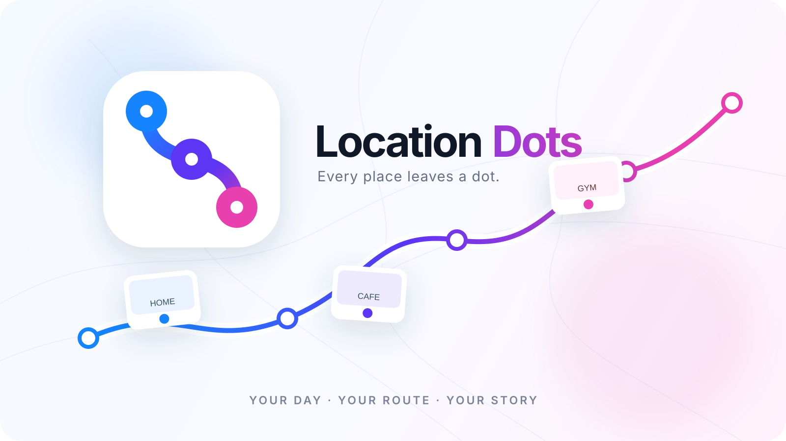
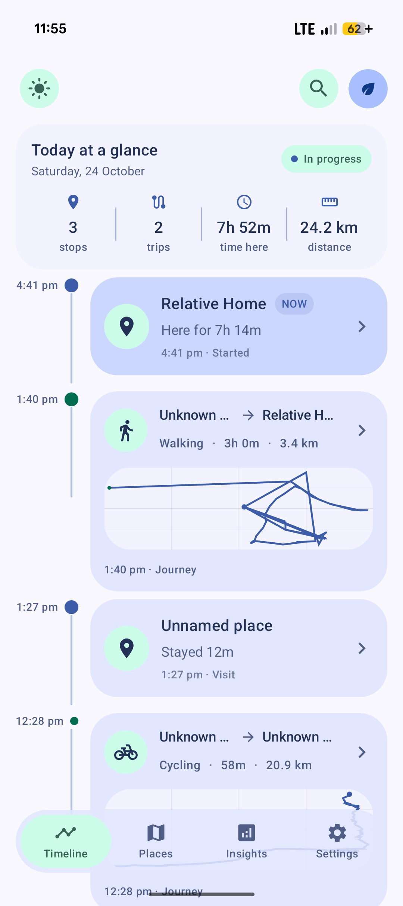
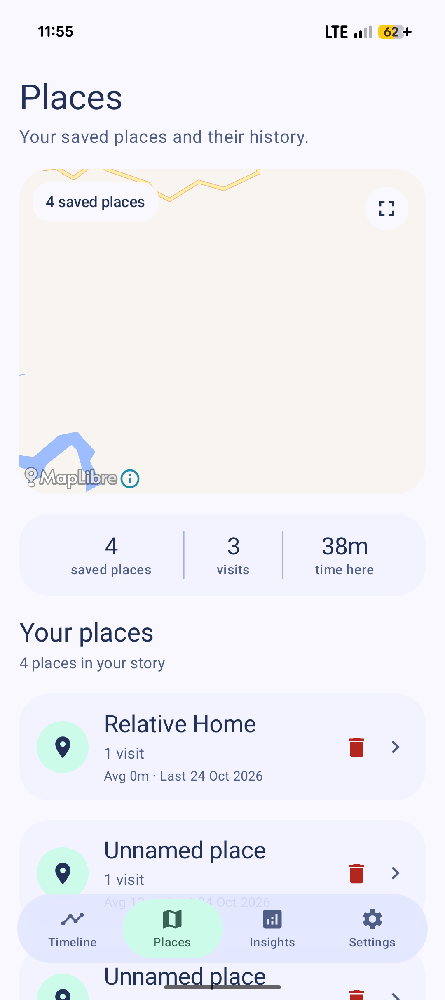
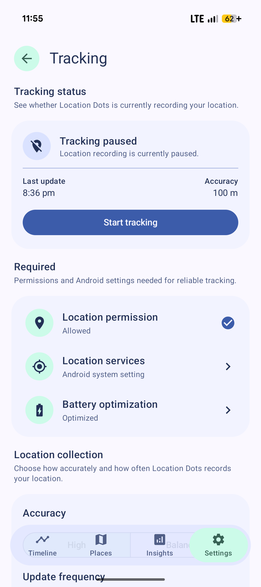
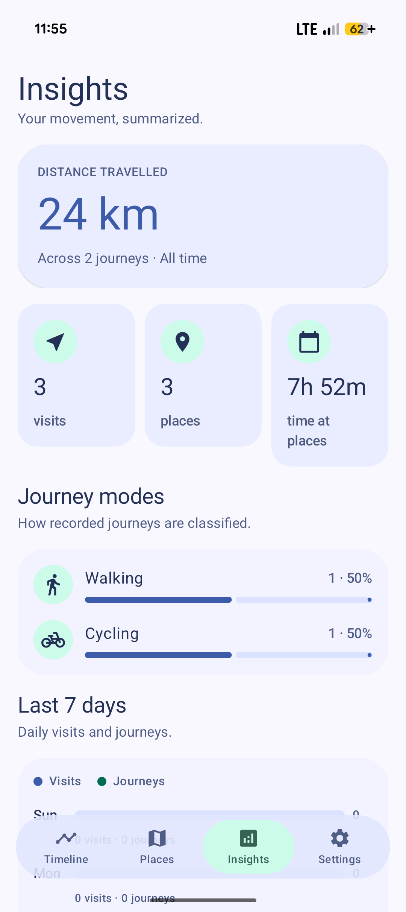
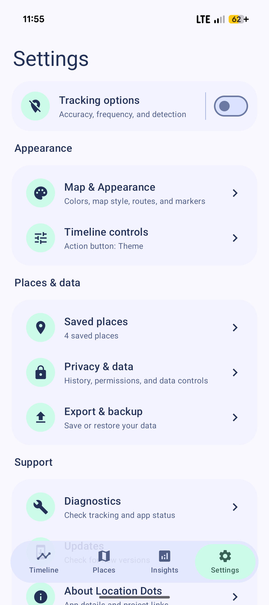

<div align="center">



# Location Dots

### Your day, turned into dots.

A private, automatic location timeline for Android. Turn everyday movement into meaningful places, visits, and journeys.

[](https://developer.android.com/)
[](https://kotlinlang.org/)
[](https://developer.android.com/compose)
[](#project-status)

[**Get it on Orion Store**](https://rookieenough.github.io/Orion-Data/redirect.html?id=location-dots&icon=https%3A%2F%2Fraw.githubusercontent.com%2Fhustlewithvikram%2Flocation-dots%2Fmaster%2Fassets%2Flocation-dots-icon.png) · [GitHub Releases](https://github.com/hustlewithvikram/location-dots/releases) · [Build artifacts](https://github.com/hustlewithvikram/location-dots/actions)

</div>

---

## What you can do

| Timeline | Places | Journeys and routes |
|:---:|:---:|:---:|
| Browse your day as visits and journeys instead of raw GPS coordinates. | Build a personal history of places you visit, rename them, and revisit their history. | Understand how you moved between places with route previews and distance information. |

| Search | Insights | Backup and restore |
|:---:|:---:|:---:|
| Find places and timeline history without endlessly scrolling. | Explore summaries of your recorded movement and time. | Export your local history to JSON and restore it when needed. |

## Screenshots

Explore the timeline, places, tracking controls, insights, and settings. Select a screenshot to view it at full size.

<table>
  <tr>
    <td align="center" width="20%">
      <a href="assets/app-screenshots/timeline_screenshot.png"></a><br>
      <strong>Timeline</strong><br><sub>Your day at a glance</sub>
    </td>
    <td align="center" width="20%">
      <a href="assets/app-screenshots/places_screenshot.png"></a><br>
      <strong>Places</strong><br><sub>Visited places, organized</sub>
    </td>
    <td align="center" width="20%">
      <a href="assets/app-screenshots/tracking_screenshot.png"></a><br>
      <strong>Tracking</strong><br><sub>Control location recording</sub>
    </td>
    <td align="center" width="20%">
      <a href="assets/app-screenshots/insights_screenshot.png"></a><br>
      <strong>Insights</strong><br><sub>Movement summaries</sub>
    </td>
    <td align="center" width="20%">
      <a href="assets/app-screenshots/settings_screenshot.png"></a><br>
      <strong>Settings</strong><br><sub>Personalize your setup</sub>
    </td>
  </tr>
</table>

## How it works

**Enable tracking → Go about your day → Visits are detected → Explore your timeline**

1. Location updates are collected while tracking is enabled.
2. History is saved locally on your device.
3. The app evaluates location accuracy and movement to identify likely stops.
4. A stay of around **8 minutes** can qualify as a visit.
5. Nearby visits can be grouped into a recognizable place.
6. Movement between places can be represented as a journey.

Detection depends on recorded location quality and app settings. GPS is not perfect, so results may not always match reality.

## Privacy-first by design

Location history is sensitive. Location Dots is designed around local storage and user control.

- Location history is stored on your device.
- The app currently does not require an account or provide a cloud location-history service.
- Normal tracking is designed to keep your history local.
- You control when to export, restore, or delete your data.
- Online map resources require an internet connection and may involve network requests to map providers.

**Local-first does not mean offline-only.** Your timeline data is stored locally, while map tiles and other online map resources may require internet access. Review the app's permissions and privacy documentation for the exact behavior of the version you install.

## Downloads

Choose how you want to install Location Dots.

| Source | What you'll find |
|---|---|
| [Orion Store](https://rookieenough.github.io/Orion-Data/redirect.html?id=location-dots&icon=https%3A%2F%2Fraw.githubusercontent.com%2Fhustlewithvikram%2Flocation-dots%2Fmaster%2Fassets%2Flocation-dots-icon.png) | Store listing and convenient installation |
| [GitHub Releases](https://github.com/hustlewithvikram/location-dots/releases) | Published release APKs |
| [GitHub Actions](https://github.com/hustlewithvikram/location-dots/actions) | Workflow builds and downloadable artifacts, when available |

**Requirements:** Android 8.0 (API 26) or newer. Location permissions and device location services are required for tracking. Online maps require internet access.

## Map styles

Location Dots uses **MapLibre** with **OpenFreeMap**. A Google Maps API key is not required.

Available styles: **Liberty · Bright · Positron · Dark · Fiord**

[Read the Maps setup guide](MAPS_SETUP.md).

## Backup and restore

From Settings, export your history as a JSON backup. Keep the file somewhere safe, then import it on the same or another device when needed. Review the restore preview before confirming.

## Build from source

**Stack:** Kotlin · Jetpack Compose · Material 3 · Room · Coroutines/Flow · Google Play Services Location · MapLibre Native

1. Clone this repository.
2. Open the project in Android Studio.
3. Allow Gradle sync to complete.
4. Build and run the app using your preferred build variant.

Automated builds:

- [Debug APK workflow](.github/workflows/build-debug-apk.yml)
- [Release APK workflow](.github/workflows/build-release-apk.yml)

Project documentation:

- [Architecture](ARCHITECTURE.md)
- [Maps setup](MAPS_SETUP.md)

<details>
<summary>Repository layout</summary>

```text
app/
├── core/       # Android/platform helpers
├── data/       # Local database and repositories
├── domain/     # Places, journeys and business logic
├── feature/    # App screens
├── service/    # Background location tracking
└── ui/         # Shared UI, theme and maps
```

</details>

## Project status

**Pre-release.** The project continues to focus on tracking reliability, edge cases, and release polish.

- Onboarding and location tracking
- Automatic visit and place detection
- Journey detection and route details
- Timeline, places, search, and insights
- Map customization
- Backup, restore, and local data deletion
- Diagnostics
- Debug and release build workflows

## Contributing

Bug reports, thoughtful suggestions, and contributions are welcome. Please include your Android version, app version, and clear reproduction steps when reporting a problem.

**Never attach your private location history or backup unless you have reviewed and intentionally removed sensitive data.**

---

<div align="center">

### Location Dots

*Every place leaves a dot.*

[Download](https://rookieenough.github.io/Orion-Data/redirect.html?id=location-dots&icon=https%3A%2F%2Fraw.githubusercontent.com%2Fhustlewithvikram%2Flocation-dots%2Fmaster%2Fassets%2Flocation-dots-icon.png) · [Releases](https://github.com/hustlewithvikram/location-dots/releases) · [Report an issue](https://github.com/hustlewithvikram/location-dots/issues)

</div>
